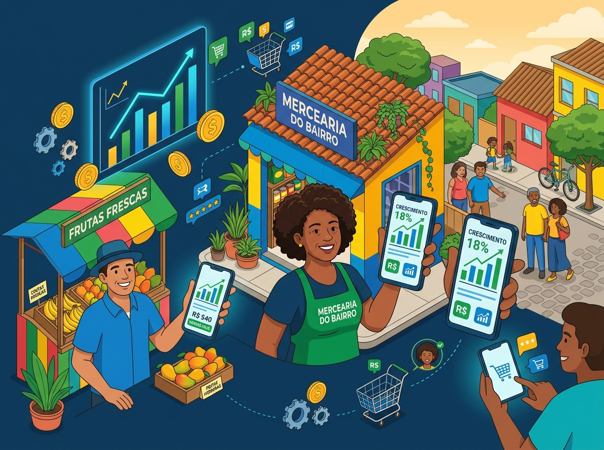

# 🌟 IMPACTA+ — Mais vitrine para o pequeno, mais fornecedores locais para o grande

> **IMPACTA+** é uma vitrine B2B que conecta o comércio do bairro às grandes empresas de **Cuiabá – MT**. Uma iniciativa institucional e social do **Senac MT**, alinhada às **ODS 8** (Trabalho Decente e Crescimento Econômico) e **ODS 9** (Indústria, Inovação e Infraestrutura), com ações de inclusão digital e redução de desigualdades (ODS 10).



---

## 🎯 Objetivo

Grandes empresas de Cuiabá precisam de fornecedores confiáveis; pequenos comerciantes e MEIs precisam de visibilidade. O IMPACTA+ aproxima os dois lados: o negócio local se cadastra em cerca de 2 minutos e passa a ser encontrado por mercados, redes e empresas compradoras.

---

## 🚀 Funcionalidades

- Cadastro de comércios locais (nome, bairro, categoria, produto/serviço e contato)
- Vitrine de fornecedores de Cuiabá com selo de verificação
- Seções institucionais: problema, nossa resposta, como funciona, indicadores de impacto e conexão com as ODS
- Formulário de contato com validação em tempo real
- API REST (Express 5) com exportação de comércios em CSV
- Layout responsivo com Tailwind CSS

---

## 🛠️ Tecnologias

- [React 18](https://reactjs.org/) + [Vite 4](https://vitejs.dev/)
- [Tailwind CSS v3](https://tailwindcss.com/)
- [Lucide React](https://lucide.dev/)
- [Express 5](https://expressjs.com/) (API e servidor do build)
- Google Fonts: *Plus Jakarta Sans* e *Inter*

---

## 💻 Como rodar localmente

**Pré-requisitos:** Node.js 18+ e npm.

```bash
git clone https://github.com/gabrielmarcony08-afk/impactamais.git
cd impactamais
npm install
```

| Comando | O que faz |
| --- | --- |
| `npm run dev` | Só o front-end (Vite) em http://localhost:3000 |
| `npm run dev:all` | Front-end (porta 3000) + API Express (porta 3001). O Vite encaminha `/api` para a API |
| `npm run build` | Gera o build de produção em `dist/` |
| `npm run serve` | Faz o build e serve tudo pelo Express (porta 3001) |

No Windows, `rodar-no-chrome.bat` inicia o servidor de desenvolvimento e abre o Chrome.

### Endpoints da API

| Método | Rota | Descrição |
| --- | --- | --- |
| GET | `/api/comercios` | Lista os comércios |
| POST | `/api/comercios` | Cadastra um comércio (`name`, `product` e `email` obrigatórios) |
| POST | `/api/login` | Login de demonstração (sem autenticação real) |
| GET | `/api/export-csv` | Exporta os comércios em CSV |

> ⚠️ Os dados da API ficam **em memória** e são perdidos ao reiniciar. Para persistência, conecte um banco de dados (ex.: MongoDB Atlas).

---

## ☁️ Publicação na Vercel

O [`vercel.json`](./vercel.json) publica o front-end (Vite, saída em `dist`) e encaminha `/api/*` para a função serverless `api/index.js`, que reutiliza o `server.js`.

> ⚠️ Na Vercel os dados em memória **não são compartilhados nem persistem** entre execuções da função. Para uso real, conecte um banco de dados (ex.: MongoDB Atlas).

1. Acesse a [Vercel](https://vercel.com/) e entre com o GitHub.
2. **Add New → Project** e importe `gabrielmarcony08-afk/impactamais`.
3. Mantenha Framework Preset **Vite** e Output Directory `dist`.
4. Clique em **Deploy**.

---

## 📄 Licença

Projeto desenvolvido para fins sociais e institucionais de apoio ao empreendedorismo local.

<p align="center">Desenvolvido com 💚 para fortalecer o pequeno comerciante brasileiro.</p>
